## Tech Stack
Programming language: C#
Interface framework: Windows Forms
Database: MySQL / MariaDB (managed via phpMyAdmin)
Version control: Git / GitHub

## Key Features

Multi-role access control: Sales department, Design department, Production department, Warehouse department, and manager level.

Order lifecycle tracking: From order placement, customization requirements, material requisition, production to shipment completion.

Inventory and customer complaint handling: Automatic inventory deduction, return and exchange processes.

## Getting Started

### Step 1: Open a Visual Studio project (.sln)

Open Visual Studio.

On the launch screen, click "Open a project or solution".

Locate the .sln file (e.g., PLFC.sln) in your project folder and double-click to open it.

If Visual Studio prompts you to install missing components (such as .NET Desktop Development), click Install.

### Step 2: Start the MySQL Database (XAMPP / MariaDB)

Since the project uses a MySQL/MariaDB architecture, you must ensure the database is running before executing the program:

Open the XAMPP Control Panel (or your MySQL management software).

Click Start next to Apache and MySQL.

Open your browser and go to http://localhost/phpmyadmin/.

Click New on the left to create a database named plfc.

Click the Import tab at the top, select your plfc(14).sql file, and execute the import.

###  Step 3: If the MySQL Connector/NET package is missing (e.g., a MySQL reference error occurs)

If you encounter a "MySql.Data not found" error during compilation in Visual Studio, please install it via NuGet:

In the Visual Studio top menu, select Tools -> NuGet Package Manager -> Manage NuGet Packages for Solution...

Search for MySql.Data.

Select your project and click Install.

### Step 4: Run the Project
Press the F5 key on your keyboard, or click the green "Start" button at the top.
After the system starts, you can log in using the default test account in the SQL file:

--------------------------------------------------------------------------------------------------------------------------------------------

# PLFC System User Guide

This guide covers the operational procedures for each department and role in the PLFC system, including login, sales, design, production, warehouse, and manager management functions [cite: 8].

## Table of Contents

- [Login] (#Login-login)

- [Sales Department] (#Sales-department)

- [Design Department] (#Design-department)

- [Production Department] (#Production-department)

- [Warehouse Department] (#Warehouse-department)

- [Manager] (#Manager-manager)

---

## Login

1. Enter your **userID** and **password** [cite: 8]. 

2. Click the **Login** button [cite: 8]. 3. The system will automatically redirect you to the corresponding department page based on your user identity [cite: 8].

3.
(Sales)      : U00001 / Password: a1234
(design)     : U00002 / Password: a1234
(production) : U00003 / Password: a1234
(whouse)     : U00004 / Password: a1234
(shipping)   : U00005 / Password: a1234
(manager)    : U00006 / Password: a1234

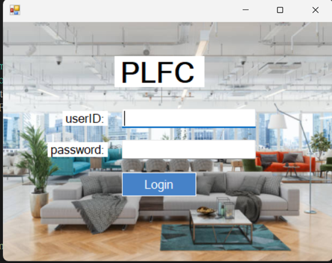
---
## Sales Department

### 1. Placing an Order

1. Go to the "New order" page, select the product category and choose the product [cite: 8].
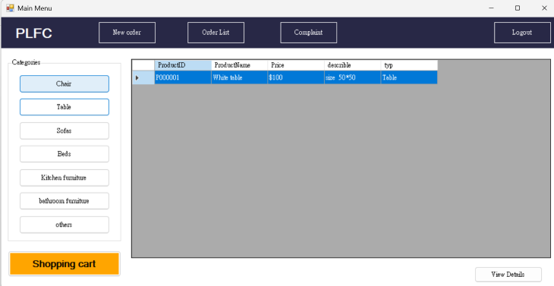

2. Click to enter the details page, enter the quantity and notes [cite: 8].

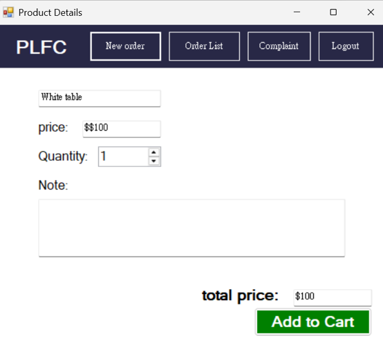
3. Click **Add to Cart** to add the item to your cart [cite: 8].
   

4. On the cart page, confirm the customer information, payment method (Cash/Visa/MasterCard), and shipping date, then click **Confirm Order** [cite: 8].

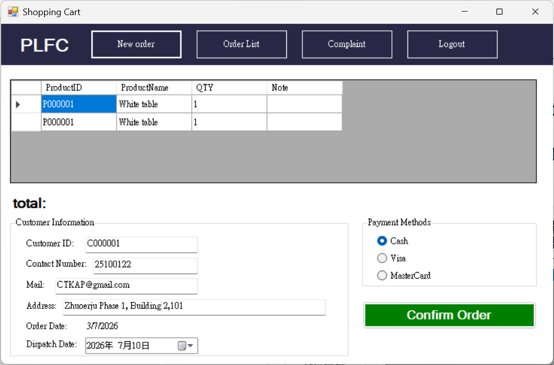

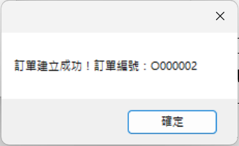

### 2. Viewing and Editing Orders

1. Click **Order List** in the main menu to view all orders [cite: 8].

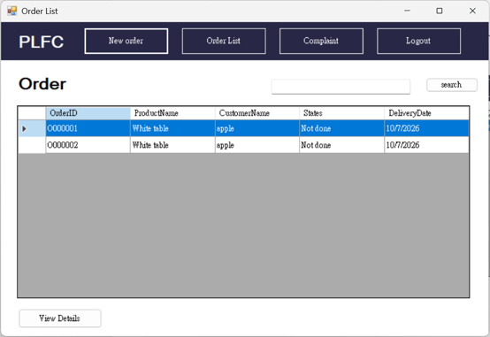
2. Click on the selected order and then click **View Details** to view the details [cite: 8].
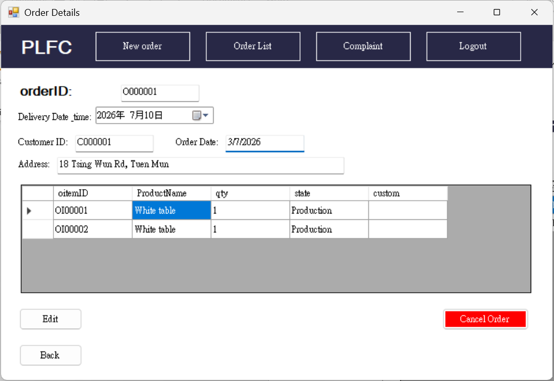
3. Click the **Edit** button to modify the delivery date or cancel an order item. Click **SAVE** when finished. [cite: 8]
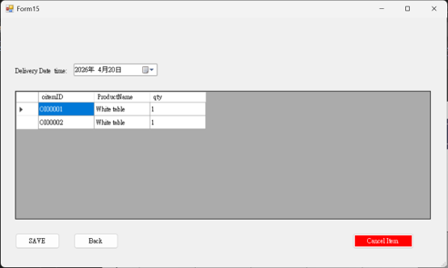
### 3. View and add complaint

1. Click **Complaint** in the main menu to access the complaint list. [cite: 8]

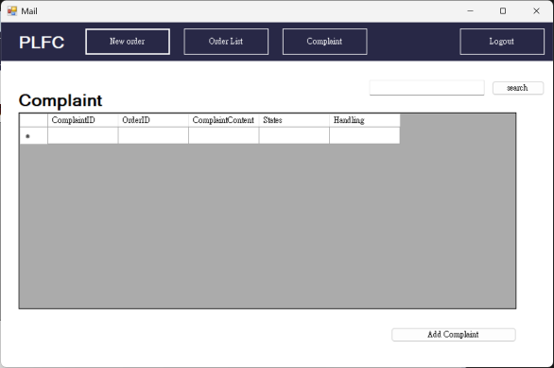
2. Click the **Add Complaint** button to fill out the customer complaint form (including customer ID, order ID, processing method, etc.) and then click **submit**. [cite: 8]
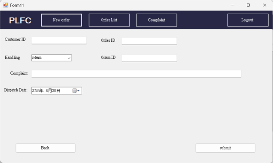

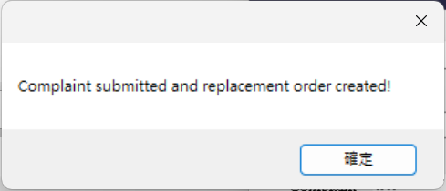
---

## Design Department

### View orders and  customization requirements

1. View orders with the status `Designing` on the Design Department homepage. [cite: 8]

2. Click **View Details** to access the form. [cite: 8]

3. View the customer's customization requirements in the **Custom** field. After the product sketch design is completed , click **Done**. The order status will automatically update to `Production`. [cite: 8]

## View orders and  customization requirements

1. View orders with the status `Designing` on the Design Department homepage. [cite: 8]

2. Click **View Details** to access the form. [cite: 8]

3. View the customer's customization requirements in the **Custom** field. After the product sketch design is completed , click **Done**. The order status will automatically update to `production`. [cite: 8]

---

## Production Department

### 1. Request Material

1. Click **Material request** to view orders in production [cite: 8].

2. Select the material, click **View Details**, enter the required quantity (Qty), and then click **order** [cite: 8].

### 2. View Material Request

1. Click **Material order List** to view the latest status of all material requests (e.g., waiting, approved, Done) [cite: 8].

## View orders and  customization requirements

1. View orders with the status ` production` on the Design Department homepage. [cite: 8]

2. Click **View Details** to access the form. [cite: 8]

3. View the customer's customization requirements in the **Custom** field. After the product sketch design is completed , click **Done**. The order status will automatically update to ` Warehouse`. [cite: 8]
---

## Warehouse Department

### 1. View Current Stock and Add Material

1. Click **Current Stock** to view the current inventory list [cite: 8].

2. Click the **add material** button, fill in the name, quantity, and price, and then click **add** [cite: 8].

### 2. Approving the Material Request

1. Click **Material order List**, select the request with the status `waiting`, and click **View Details** [cite: 8].

2. After verifying that everything is correct, click **approve** to complete the approval [cite: 8].

### 3. Changing Complaint's Status

1. Click **Complaint**, select the complaint item, and click **View Details** [cite: 8].

2. After the system pops up the processing window, click **Yes (Y)** to indicate that it has been processed, or click **Cancel** [cite: 8].

---

## Manager

### 1. Marking an Order as Done

1. Select the order in the `shipping` status and click **View Details** [cite: 8].

2. Click **done**, and in the confirmation window, click **Yes (Y)** to mark the order as `Done` [cite: 8].

### 2. Mark material request as Done

1. Go to **Material order List**, select the approved request, and click **View Details** [cite: 8].

2. Click **Done** to complete the process [cite: 8].

### 3. Mark return order as Done

1. Go to the **Complaint** page to view the return order [cite: 8].

2. Select the complaint and click **View Details**, confirm the information, and then click **done** to update the status [cite: 8].

